# PS — Prose & Source

Native macOS editor (Swift + AppKit) that behaves like VS Code for code and like a word
processor for `.rtf`, `.rtfd` and `.txt` documents. A single `NSTextView` set up in two
ways, no dependencies.

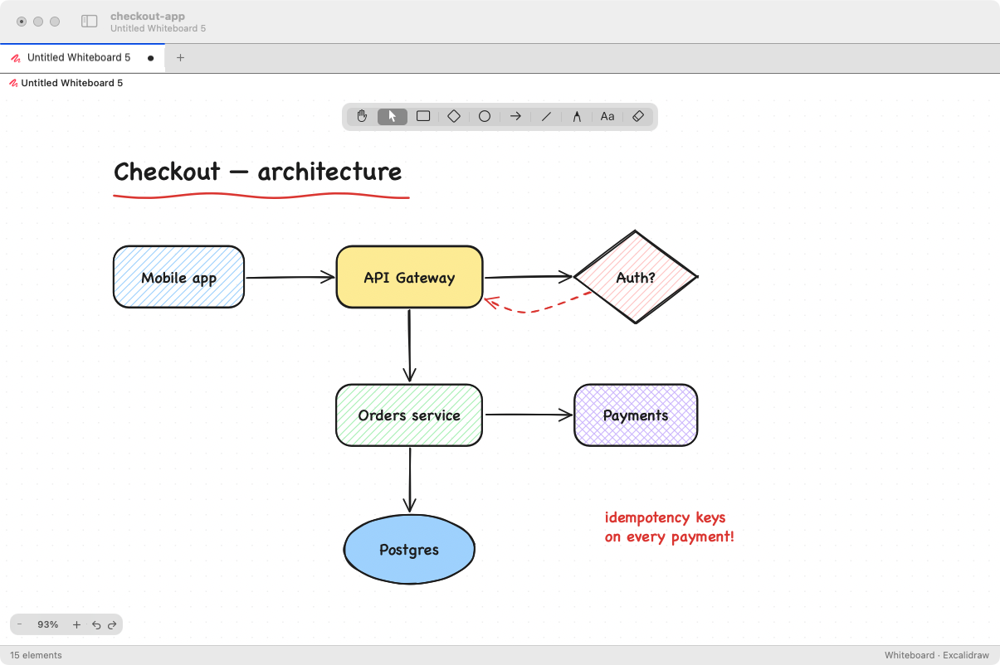

| | |
|---|---|
| 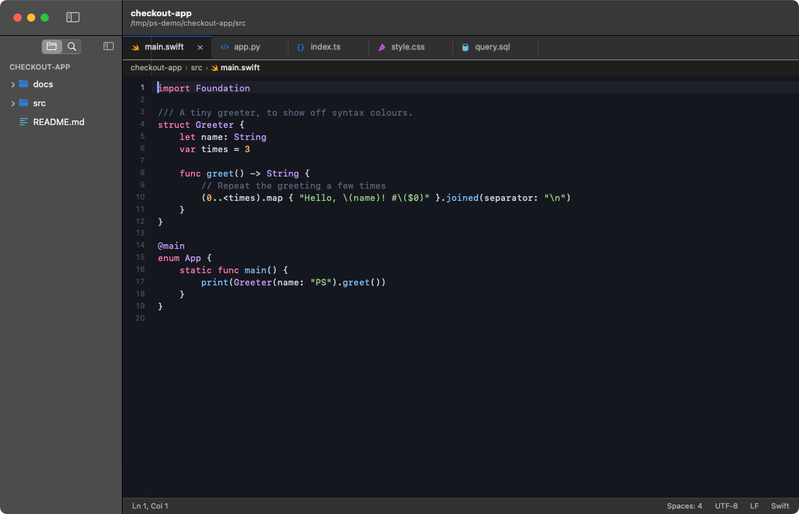 | 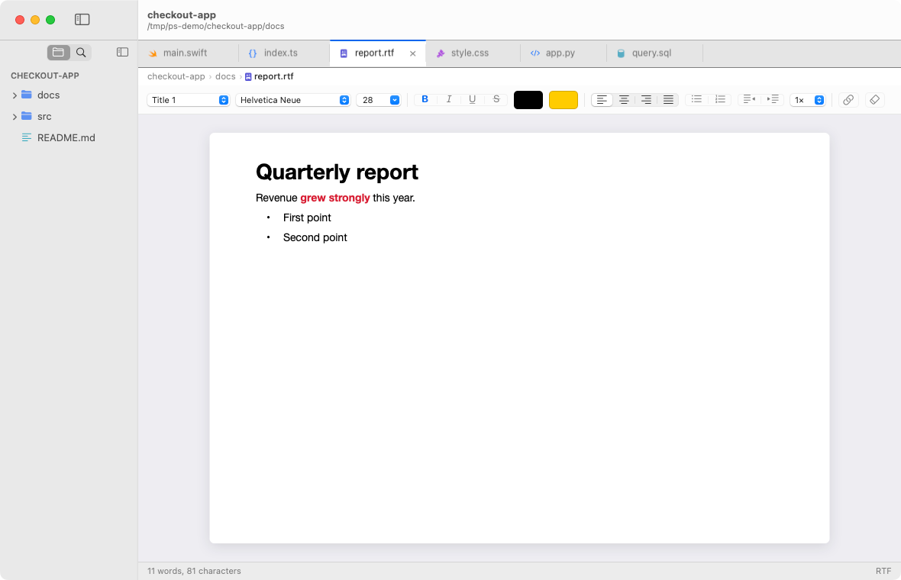 |
| 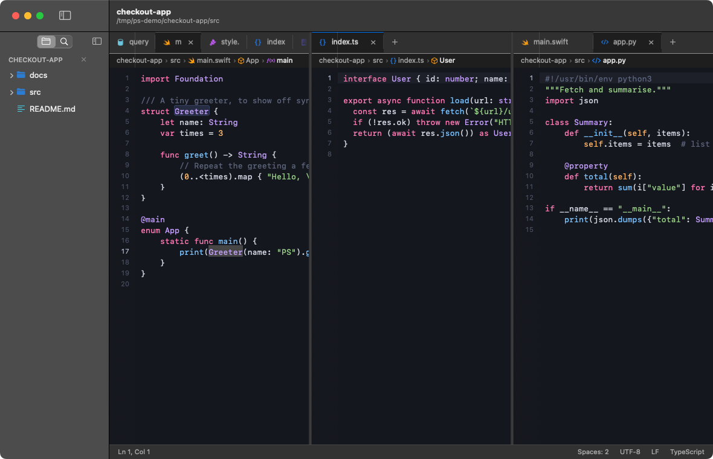 | 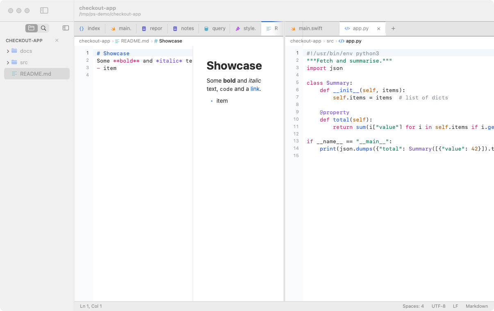 |
| 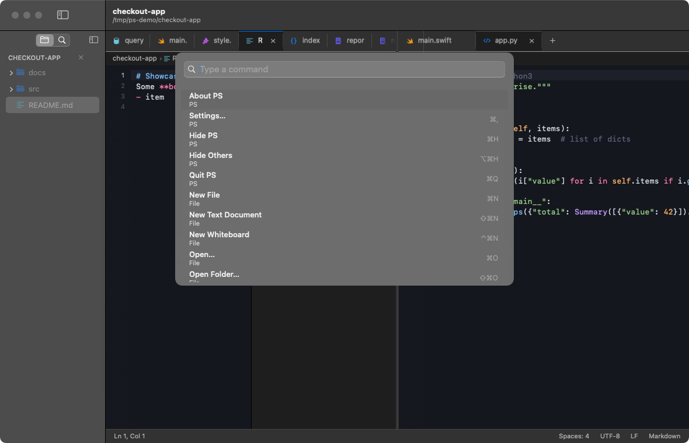 | 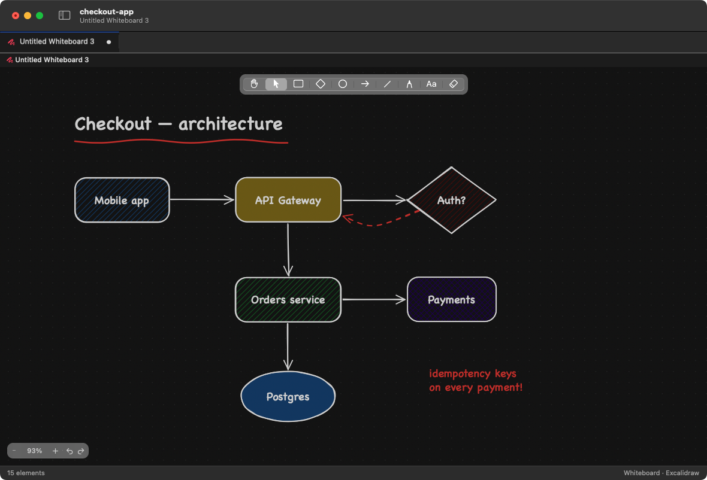 |
| 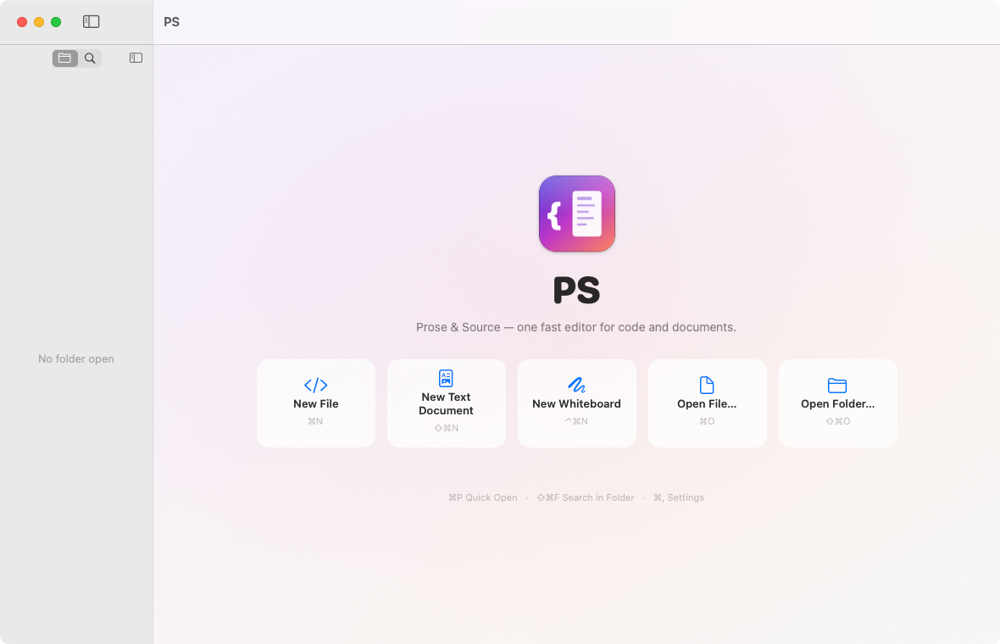 | 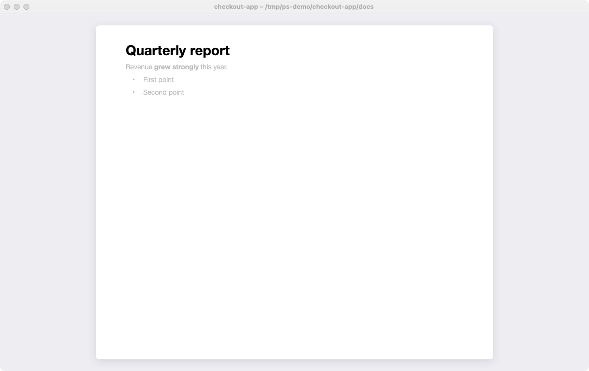 |
| 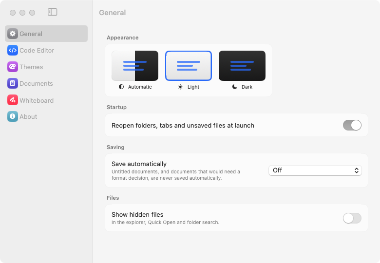 | 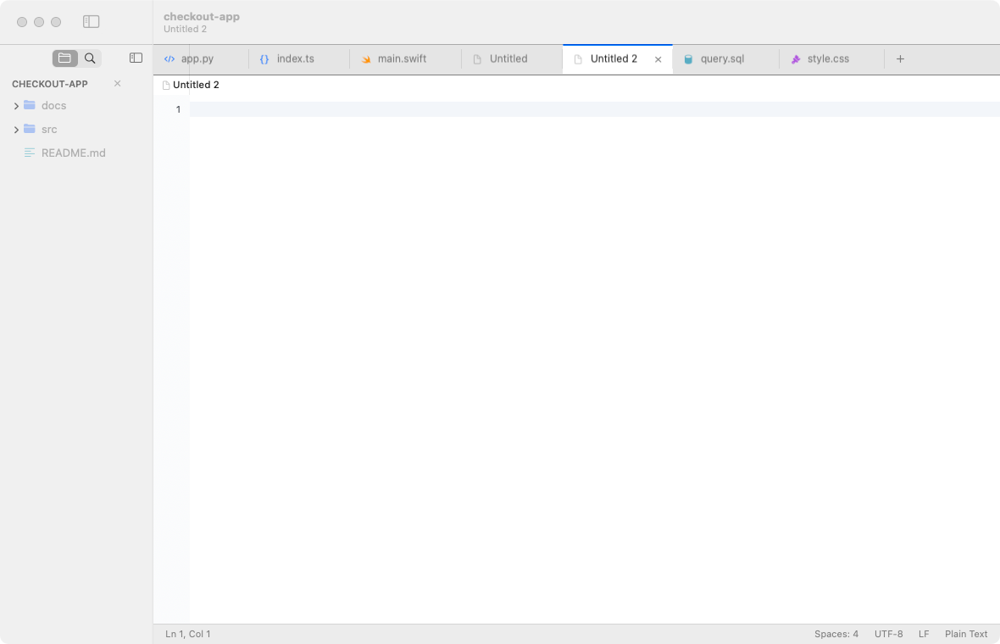 |
| 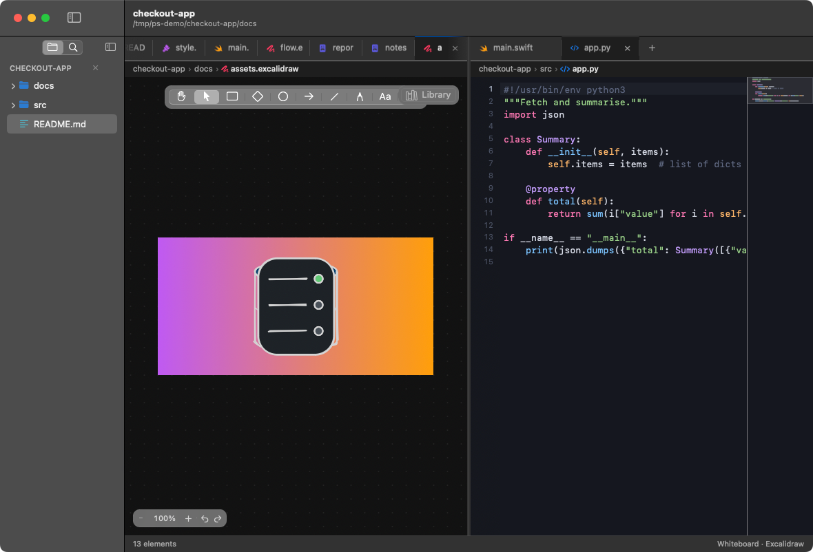 | 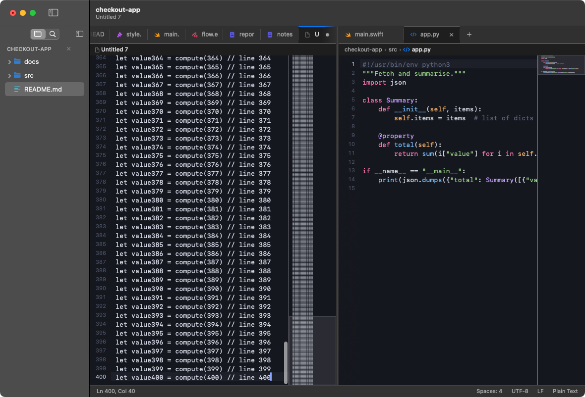 |

## Installation

There is no ready-made release: you build the app from source (about a minute).

**Requirements**

- macOS 13 Ventura or later, on Apple Silicon or Intel.
- **Xcode 15 or later** (from the App Store), opened at least once to accept the licence.
  The Command Line Tools alone are not enough: the universal build uses Xcode's build system.
  If `xcode-select -p` doesn't point at Xcode: `sudo xcode-select -s /Applications/Xcode.app`.

**Build and install**

```sh
git clone https://github.com/markuz899/ps.git
cd ps
./scripts/build-app.sh                  # → build/PS.app (universal, ~5 MB)
ditto build/PS.app /Applications/PS.app # install
open /Applications/PS.app
```

To update: `git pull`, run `./scripts/build-app.sh` again and copy the app again.

**First launch**

- An app built on your own Mac opens without warnings.
- The app is signed *ad hoc* (no Apple developer certificate). If you copy it to **another
  Mac** (AirDrop, zip, download), macOS will say it can't be opened or is damaged: on that
  Mac, right-click the app ▸ Open ▸ Open, or run
  `xattr -dr com.apple.quarantine /Applications/PS.app`.

**Opening files with PS**

- From the welcome screen, File ▸ Open (⌘O) or Open Folder (⇧⌘O), or by dropping files and
  folders onto the window.
- From the terminal: `open -a PS file.swift` or `open -a PS my-project/`.
- To make it the default app for a type: Finder ▸ select a file ▸ File ▸ Get Info ▸
  "Open with" ▸ PS ▸ "Change All…".

**Uninstall**

```sh
rm -rf /Applications/PS.app
defaults delete app.prose-source.PS                 # settings, session, recents
rm -rf ~/Library/Application\ Support/PS             # only if you added your own themes
```

**Troubleshooting**

- `error: No target named 'PS-debug.exe' in build description` (seen with Xcode 15.3):
  delete the build cache with `rm -rf .build` and run the script again.
- Window in the wrong place or with odd sizes after an update: `defaults delete
  app.prose-source.PS "NSWindow Frame PSMainWindow"`.

## Building for development

Requirements: Xcode 15 or later (Swift 5.9+), macOS 13+.

```sh
./scripts/build-app.sh          # universal (arm64 + x86_64) release → build/PS.app
open build/PS.app
swift test                      # tests for the non-visual logic (PSCore)
./scripts/measure.sh            # reproduces the measurements below
```

From Xcode: `File ▸ Open…` on the folder (it opens `Package.swift`), `PS` scheme, Run. That
way it runs as a bare executable (no bundle): it works, but without the icon or the Italian
localization, which are added by `build-app.sh`.

Test modes built into the binary (used for the report):

| Flag | What it does |
|---|---|
| `--measure` | time from process start to the first window frame, plus memory at rest after 3 s |
| `--bench <file>` | open time, max main-thread stall, cost per keystroke and per scroll frame |
| `--selftest <folder> <screenshots>` | runs the acceptance criteria inside the real app (windows, sheets, files) and saves screenshots |
| `--selftest-restore <folder>` | second half: checks session restore after a relaunch |

## Whiteboard

File ▸ **New Whiteboard** (⌃⌘N) opens an infinite canvas for sketching ideas, software
architectures, application flows and diagrams, in the spirit of [Excalidraw](https://excalidraw.com).

- **Excalidraw format**: boards are saved as `.excalidraw` files, so they open on
  excalidraw.com and Excalidraw files open in PS. Copied elements use Excalidraw's clipboard
  format: paste them straight into excalidraw.com (and back).
- **Tools** (same keys as Excalidraw): hand `H`, selection `V`/`1`, rectangle `R`/`2`,
  diamond `D`/`3`, ellipse `O`/`4`, arrow `A`/`5`, line `L`/`6`, pencil `P`/`7`,
  text `T`/`8`, eraser `E`/`0`. Shift keeps squares and 15° angles.
- **Hand-drawn look**: sketchy strokes with three levels of sloppiness (architect, artist,
  cartoonist), hachure / cross-hatch / solid fills, stroke colours and widths, dashed and
  dotted lines, rounded or sharp corners, opacity, a hand-written font.
- **Diagrams**: arrows dropped on a shape attach to it and follow it when it moves;
  double-click a shape to write inside it; arrowheads (arrow, triangle, dot).
- **Editing**: click / shift-click / marquee selection, move, resize from the corners,
  arrow keys to nudge, ⌘D duplicate, ⌘G / ⇧⌘G group and ungroup, layer order,
  Delete, unlimited undo.
- **Canvas**: pinch or ⌘-scroll to zoom, scroll or space-drag to pan, ⌘+ / ⌘- / ⌘0,
  dotted grid; in dark mode colours are inverted the way Excalidraw does it.
- **Pictures**: paste an image (⌘V) or drop image files from the Finder; resize them from
  the corners (proportions kept, ⇧ to free them). They're embedded in the `.excalidraw`
  file the way Excalidraw stores them, so they open on excalidraw.com too.
- **Library**: the Library button (top right) has ready-made pieces for diagrams —
  database, server, user, queue, cloud, browser, phone, document, sticky note. Each is a
  group of ordinary elements: move it as one, ungroup (⇧⌘G) to edit its parts.
- **Export**: File ▸ Export as PNG… or ⌥⇧⌘C (the selection, or the whole board).

Not supported yet: rotation handles (rotated elements from Excalidraw are drawn rotated),
frames, live collaboration.

## Minimap

Code files show a scaled-down map of the whole file on the right, in the syntax colours,
with the visible part shaded: click or drag on it to jump. Settings ▸ Code Editor ▸
Minimap turns it off.

## Tabs

- A **+** after the last tab (like Sublime Text) opens a new file in that pane;
  right-click it for a text document or a whiteboard. Double-clicking the empty part of the
  tab bar does the same.
- When a pane is too narrow for its tabs, they shrink and their titles end in "…"; past a
  minimum width the bar scrolls, with a fade at the edges instead of a hard cut.

## Settings

PS ▸ Settings (⌘,) is laid out like System Settings: sections in a sidebar, grouped options,
live previews.

| Section | Options |
|---|---|
| General | Appearance (Automatic / Light / Dark, independent of macOS), reopen the session at launch, auto-save (off / on focus change / every N seconds), hidden files |
| Code Editor | Font, size and line height with a live preview, tab width, spaces vs tabs, line numbers, minimap, word wrap, current-line highlight, occurrence highlight, CSS colour swatches, auto-closing brackets |
| Themes | One theme for light mode and one for dark mode, picked from preview cards; custom JSON themes in `~/Library/Application Support/PS/Themes` |
| Documents | Default font and size for new text documents (with preview), spell checking |
| Whiteboard | Dot grid, default sloppiness and font for new elements |
| Keyboard Shortcuts | Every shortcut, searchable: read from the menus (always current) plus the ones outside them — whiteboard tools, mouse gestures, tabs |
| About | Version and project link |

## Closing a folder

File ▸ **Close Folder** (⌥⇧⌘W), or the × next to the folder name in the sidebar, stops
working on the open folder: the tabs of its files close (asking about unsaved changes —
Cancel stops everything), tabs of files from elsewhere and new unsaved files stay open, the
explorer, folder search and Quick Open are emptied, and the next launch won't reopen it. It
stays in File ▸ Open Recent.

## Unsaved files

New files you never saved don't block quitting: they come back, with their content and
still marked unsaved, the next time PS starts (kept in
`~/Library/Application Support/PS/Unsaved/`). Closing a single tab or window still asks.

## Extras

| Feature | How |
|---|---|
| **Split panes** (up to 4) | ⌘\ or the tab's context menu "Split Right". Each pane has its own tabs; the same file can be open in two panes (one document, two views). "Move to New Pane / to Pane N", drag the divider to resize it (double-click = equal widths), ⌃⌘← / ⌃⌘→ to switch pane. Panes are restored on relaunch. |
| **Dragging tabs** | Drag a tab vertically out of its bar: you can drop it on another pane's tab bar (an indicator shows where it lands) or on a pane's editor (it gets highlighted). Dropped **outside the app**, it opens a new window at that spot, with the same folder. A window left with no tabs closes itself; with a single tab, the drag just moves the window. Also from the tab's menu: "Move to New Window". |
| **Multiple windows** | ⌥⌘N opens a new window. A file is never open in two windows: opening it again brings forward the window that already has it. On quit each window asks about its own documents; the session saves and restores every window. |
| **Command Palette** | ⇧⌘P: every menu command, searchable with fuzzy matching, with its shortcut. |
| **Focus mode** | ⇧⌘↩: sidebar, toolbar, tabs and bars go away; only the pane you're in stays. In documents, everything except the current paragraph is dimmed and the line stays centred (typewriter scrolling). |
| **Markdown preview** | ⇧⌘V on a `.md` file: rendered preview on the side (Foundation's parser, no WebView), with synced scrolling. The `.md` file stays code. |
| **Colour swatches** | In CSS/HTML/JS/TS/JSON/YAML/XML a swatch appears next to `#rrggbb`, `rgb()`, `rgba()`; clicking it opens the colour panel and the code updates as the colour changes. |
| **Occurrences** | The word under the caret is softly highlighted wherever else it appears on screen. |
| **Replace in folder** | In the Search pane: "Replace All…" shows every change (− old line / + new line) before applying it. Open files are changed in their tab (undoable), the others on disk keeping encoding and line endings; `.rtf` files on disk are skipped. |
| **Code as image** | ⌥⇧⌘C copies to the clipboard (or Code ▸ Export Code as Image…) a 2× PNG of the selection or the whole file: macOS-style window on the app gradient, with the theme's colours. |
| **Breadcrumb** | Under the tabs: folder › file › enclosing declarations (`Greeter › greet`). Clicking the file or a declaration opens the file's outline; clicking a folder reveals it in the sidebar. |
| **Multiple cursors** | ⌥click adds a caret, ⌘D selects the next occurrence, ⌥⌘↑/↓ add a caret above/below, Esc goes back to one. Typing, Backspace, Return, Tab, ←/→ and paste (one line per caret when the counts match) act on all of them; one undo reverts everything. |

## Module structure

```
Sources/PSCore/            non-visual logic, fully tested
  Languages.swift          language registry + grammars (one entry per language)
  Tokenizer.swift          regex tokenizer with an offset/limit window (incremental)
  Theme.swift              JSON theme loading (Resources/Themes, ~/Library/Application Support/PS/Themes)
  TextFileIO.swift         encodings, BOM, LF/CRLF/CR, binary detection, atomic writes, indent detection
  RichTextIO.swift         editor mode by file type, RTF/RTFD/TXT, export, .txt save rules
  Search.swift             find/replace, fuzzy match, folder search
  LineIndex.swift          incremental line index (offset → line in O(log n))
  Symbols.swift            outline per language (breadcrumb), regex-based
  CodeAssist.swift         colour literals, multi-cursor arithmetic, Markdown renderer
Sources/PS/
  App/                     lifecycle, menus, main window, status bar, welcome screen, session, icon, bench, self-test
  Workspace/               file tree (NSOutlineView, lazy loading), FSEvents
  Documents/               document model shared by both modes
  Tabs/                    tab bar, breadcrumb, pane container with dividers
  CodeEditor/              code editor: line numbers, auto-indent, brackets, line commands
  Highlighting/            incremental highlighter (temporary attributes)
  RichEditor/              word-processor view, formatting bar, lists, links
  Search/                  find bar, folder search, Quick Open
  Settings/                UserDefaults preferences + SwiftUI Settings window
```

The central point: `Document` has a `mode` (`code`/`rich`) decided at open time by
`EditorMode.forFile`. The tab hosts a `DocumentEditor` (`CodeEditor` or `RichEditor`); tabs,
saving, find, status bar and session only see `Document` + `DocumentEditor.textView`. File
reads, folder search, Quick Open indexing and the initial highlighting pass for large files
run off the main thread.

To add a language: one `Language(...)` entry in `LanguageRegistry.all` with its rules.
To add a theme: one JSON file in `Themes/` (or in the user folder).

## Dependencies

**None.** Everything comes from the system frameworks:

- **Syntax highlighting**: I chose not to use Tree-sitter. Supporting 19 languages would have
  meant 19 C grammars plus a Swift binding (several MB of bundle, longer builds, an extra C
  toolchain). Instead there is a regex tokenizer, still incremental: after an edit only the
  touched paragraphs are re-tokenized, widened to any multi-line token they fall inside
  (block comments, multi-line strings). Colours are TextKit temporary attributes: they never
  reach disk or undo, and repainting them doesn't touch the text. The known limit: it doesn't
  "understand" the syntax (e.g. JS/CSS embedded in HTML is not coloured).
- **RTF / RTFD / DOCX / HTML**: `NSAttributedString` (AppKit).
- **File watching**: FSEvents (CoreServices).
- **Settings**: SwiftUI, which ships with the system and is loaded only when the window opens.

## Keyboard shortcuts

| Action | Keys |
|---|---|
| New file (code/plain text) · New text document | ⌘N · ⇧⌘N |
| Open · Open folder · Close folder · Quick Open | ⌘O · ⇧⌘O · ⌥⇧⌘W · ⌘P |
| Save · Save As · Save All | ⌘S · ⇧⌘S · ⌥⌘S |
| Close tab · Close window | ⌘W · ⇧⌘W |
| Next/previous tab · Tab N (⌘9 = last) | ⌃⇥ / ⌃⇧⇥ · ⌘1…⌘9 |
| Find · Find and replace · Next/previous · Use selection | ⌘F · ⌥⌘F · ⌘G / ⇧⌘G · ⌘E |
| Find in folder · Explorer · Toggle sidebar | ⇧⌘F · ⇧⌘E · ⌃⌘S |
| Command Palette · New window · New whiteboard | ⇧⌘P · ⌥⌘N · ⌃⌘N |
| Sidebar: show / hide | ⌃⌘S, the button in the title bar or in the sidebar |
| Split editor · Next/previous pane | ⌘\ · ⌃⌘→ / ⌃⌘← |
| Focus mode · Markdown preview | ⇧⌘↩ · ⇧⌘V |
| Multiple cursors: next occurrence · caret above/below · add caret | ⌘D · ⌥⌘↑ / ⌥⌘↓ · ⌥click |
| Copy code as image | ⌥⇧⌘C |
| Go to line · Change language | ⌃G · ⇧⌘L |
| Toggle comment · Indent / Outdent | ⌘/ · ⌘] / ⌘[ (also Tab / ⇧Tab on a selection) |
| Duplicate line · Move line up/down · Delete line | ⇧⌥↓ · ⌥↑ / ⌥↓ · ⇧⌘K |
| Word wrap · Zoom in / out / actual size | ⌥Z · ⌘+ / ⌘- / ⌘0 |
| Bold · Italic · Underline · Strikethrough | ⌘B · ⌘I · ⌘U · ⇧⌘X |
| Normal / Title 1 / 2 / 3 / Quote | ⌥⌘0 / ⌥⌘1 / ⌥⌘2 / ⌥⌘3 / ⌥⌘4 |
| Numbered list · Bulleted list · List level | ⇧⌘7 · ⇧⌘8 · Tab / ⇧Tab |
| Link · Clear formatting · Paste and match style | ⌘K · ⌥⌘\ · ⌥⇧⌘V |
| Align left / center / right | ⌘{ · ⌘\| · ⌘} |
| Print · Settings | ⌥⌘P · ⌘, |

⌘P goes to Quick Open (VS Code convention, required by the spec); printing is therefore on ⌥⌘P.

---

## Final report

### Measurements (M1, macOS 14.0, universal release build)

| Target | Result | Method |
|---|---|---|
| Cold start < 0.5 s | **0.28–0.32 s** (first run after a build: up to 0.67 s) | `--measure`: process start time (`sysctl KERN_PROC_PID`) → first window frame drawn. 5 consecutive runs. A true cold start after a reboot was **not** measured. |
| Memory at rest < 80 MB | **19.5–28 MB** | `--measure`: `phys_footprint` (the figure Activity Monitor shows) 3 s after the empty window opens |
| Bundle < 30 MB | **5.0 MB** (universal, whiteboard included) | `du -sh build/PS.app`; `lipo -info` → `x86_64 arm64` |
| Smooth on 10,000 lines | typing **1.0 ms** avg / 3.6 ms p95 per keystroke; scrolling **1.0 ms**/frame; opens in 104 ms (longest stall 135 ms) | `--bench`: 200 keystrokes in the middle of the file, each one = insert + incremental highlight + full redraw; 120 half-page scrolls with redraw |
| 5 MB without blocking | opens in **129 ms**, longest main-thread stall **170 ms**, typing 3.8 ms | `--bench` with a 5-ms timer that measures the gaps on the main thread while the file opens. Above 5 MiB highlighting turns off and the status bar says so. With a 4.5 MB file *with* highlighting: 113 ms to open, 122 ms max stall (the background pass is applied in chunks of 4,000 tokens) |

A measurement that changed the code: the first version computed `String.hashValue` on every
keystroke to clear the dirty dot after undo. It cost 13.6 ms per key on the 10k-line file
and 269 ms when opening the 5 MB file. Replaced with a literal comparison against a copy of
the saved text (memcmp): 0.9 ms per key. Second case, with the extras: the breadcrumb
rescanned the whole file on every keystroke (21 ms per key); the scan now runs in the
background 0.4 s after typing stops (back to 1.0 ms). Between runs the stall when opening
large files varies a lot (120–330 ms over the session): a profile shows it spread across the
first layout of the window, creating the editor and applying the colours in chunks, with no
single cause.

### Acceptance criteria

"Verified" = checked by running the app (`--selftest` + `--selftest-restore`, real windows and
files, 148 checks, all passed in light and dark mode, plus 39 unit tests). "Deduced" = from the code only, not run.

| Criterion | Outcome |
|---|---|
| Folder + 5 files in 5 different languages, all coloured | **Verified** (Swift, Python, TypeScript, CSS, SQL; colour checked on a keyword in each) |
| Change language → colouring updates immediately | **Verified** through the same function the picker calls. The click in the status-bar popover was not automated. |
| Two modified files, quit → asked for both | **Verified**: two separate sheets, one per file, on the path `applicationShouldTerminate` uses. The physical ⌘Q was not pressed. |
| New document: title, bold + coloured, bulleted list; save, close, reopen → identical | **Verified** with the same commands the bar and shortcuts invoke (not physical clicks). After reopening, Title 1 (28 pt bold), bold, red and list all match. |
| .rtf opens in TextEdit and Word, and vice versa | **TextEdit: verified** in both directions using `textutil` (TextEdit's engine). **Word: not verified** (not installed on this Mac). The RTF is written by the standard Cocoa writer, the same one TextEdit uses. |
| Modified .txt without formatting → plain .txt, byte-identical | **Verified** (CRLF kept, bytes compared) |
| .txt + bold → choice offered, original intact | **Verified**: the sheet appears, "Convert to RTF" is clicked, `notes.rtf` is created next to it, the `.txt` doesn't change and the tab moves to the `.rtf` |
| .py/.swift never show the bar; .rtf has no line numbers or colouring | **Verified** |
| Folder search finds the string and jumps to the right line | **Verified** in the app (click on a result → main.swift line 17). The "several files" case is verified in the unit tests (`testFolderSearchFindsLines`); in the demo folder the string was in one file only. |
| Restart → folder, tabs, cursor | **Verified** with two separate launches (two panes too) |
| Lightness targets | **Verified** (table above) |

Extras verified in the app: split into 2 and 3 panes with equal widths and the window keeping
its size, the same file in two panes (typing in one shows up and gets coloured in the other),
moving tabs between panes, closing a pane, breadcrumb `main.swift › Greeter › greet`, ⌘D
twice → 3 selections replaced by typing and restored with one undo, the CSS swatch rewritten
as `#ff0000` from the colour panel, replace in folder on disk, Markdown preview, a Command
Palette command run, focus mode (one pane only, then all of them back), a PNG of the code;
moving a tab via drop on the tab bar and on another pane's editor, tearing a tab off into a
new window (same document, same folder, editor moved to the new window), no duplicate when
reopening it from the other window, and the emptied window closing by itself.

Also verified: silent reload of a file changed on disk (FSEvents), incremental highlighting
(typing `/*` turns the following lines into a comment, undo restores them and clears the dirty
dot), Italian interface and light mode.

### Decisions on ambiguous points

- **Tree-sitter → own regex tokenizer** (reasons above).
- **"New file"**: two commands (⌘N code, ⇧⌘N document) instead of a dialog on every creation;
  both are also on the welcome screen.
- **Single window**: the spec doesn't ask for more, and it keeps the app simpler.
- **Saving is synchronous**: a single atomic write (temporary file + replace) of data already
  encoded in memory, which keeps the order of close/quit operations guaranteed. Measured at a
  few ms even at 5 MB. Reads, searches and indexing are async.
- **Default font for documents: Helvetica Neue**. The system font would write
  `.AppleSystemUIFont` into the RTF, which Word and other machines don't recognise.
- **Text colour**: unformatted text is stored as black and shown inverted in dark mode
  (`usesAdaptiveColorMappingForDarkAppearance`). Otherwise an RTF saved in dark mode would
  come out white on white in Word.
- **.rtf with images**: same rule as .txt: "Convert to RTFD" (new file next to it) or "Save
  without images".
- **Mixed line endings**: the file is normalised to the majority ending on save.
- **Paragraph styles**: RTF has no named styles, so "Title 1/2/3/Quote" are recognised from
  size and weight (heuristic).
- **Links**: open with ⌘-click; a normal click places the cursor, as in Word.
- **Auto-save**: never on untitled documents or on ones that would require a format decision.

### Not done or incomplete

- **Multiple cursors**: ↑/↓ and the other movements (Home/End, words) go back to a single
  caret; auto-closing of brackets doesn't apply with several carets.
- **Drag and drop of tabs**: the self-test exercises the drop logic directly; a real
  mouse drag (the start of the drag session, the indicator) was not automated.
- **Multiple windows**: restoring a session with more than one window is in the code but was
  not verified (the self-test's session ends with one window).
- **Tables**: only the system "Insert Table…" panel (`orderFrontTablePanel`), not tested.
- **Untitled tabs** are not restored with the session.
- **VoiceOver**: labels and roles set on tabs, file tree, formatting bar, find bar and status
  bar, but **not tested** with VoiceOver running.
- **Interactions not automated**: dragging tabs and pane dividers, dragging in the tree,
  inline rename, Finder drag-and-drop, the language popover, ⌥click with the mouse,
  print/PDF/DOCX export, the "Replace All…" preview sheet (the self-test calls the replace
  directly). They are in the code but were
  not exercised by the self-test.
- **Highlighting**: no embedded languages (JS/CSS inside HTML, code inside Markdown is shown
  as a string); nested Swift/Rust comments are not handled.
- **Numbered lists**: renumbered when levels change and on Return; deleting an item in the
  middle doesn't renumber the following ones.
- **Formatting**: no Swift formatter is installed (Xcode 15.3 doesn't include `swift-format`).
  I checked by hand: 4-space indentation, no tabs, no trailing spaces, final newline in every
  file. About fifty lines are longer than 100 characters, mostly the keyword lists in the
  grammars.
